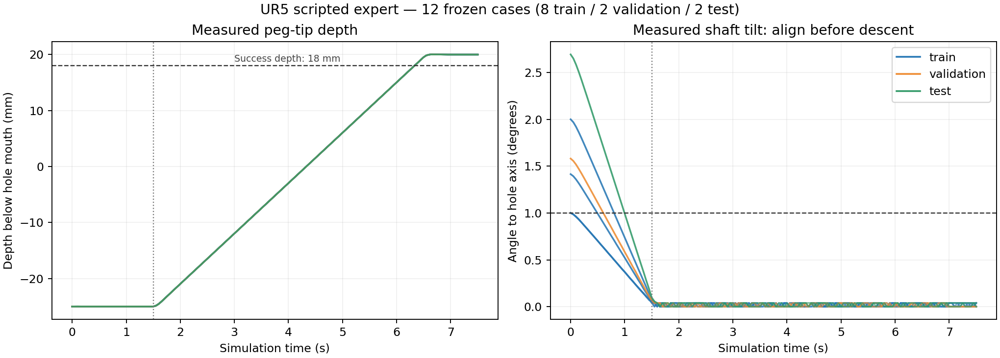
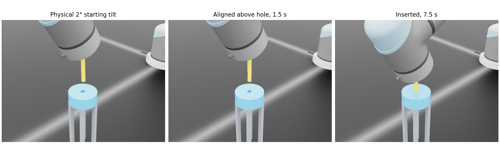

# Açılı başlangıçlar ve ilk ayrık veri seti — 15 Kasım 2026

UR5'in rijit pim–delik uzmanı artık hem konum hem açı farkını düzeltiyor. Önceden belirlenen 12 başlangıcın tamamı başarılı oldu. Bu kayıtlar, veri dönüşüm hattını sınayan küçük bir pilot oluşturur. Robotu hâlâ simülatördeki delik pozunu bilen betikli uzman kontrol eder; öğrenilmiş UR5 politikası henüz yoktur.

## Fiziksel başlangıç nasıl değişti?

İlk sürümde pim aşağıya düz bakıyordu. Yeni sürüm, kayıt başlamadan önce robotu gerçekten hareket ettirerek pimi yaklaşık 1–2,69° eğik duruma getirir. Pim ucu delik ağzının 25 mm üstünde tutulur. Hazırlık hareketi 30 kontrol adımı ve 10 bekleme adımı sürer; veri bölümüne katılmaz. İstenen açı ile ölçülen başlangıç yönelimi arasındaki fark 0,15° altında olmalıdır.

Eğitimde kaydedilen uzman hareketi 7,5 saniyedir:

1. İlk 1,5 saniyede pim, delik üzerinde konum ve açı bakımından hizalanır.
2. Sonraki 5 saniyede yavaşça 20 mm derine iner.
3. Son 1 saniyede hedefte bekler. Ölçülen poz, son en az 10 adımda başarı koşullarını sağlamalıdır.

Kamera bütün senaryolarda aynı konum ve yönelimdedir. Delik kaydığında kamera otomatik olarak ona dönmez. Görüntüden konum farkını öğrenme koşulu böylece korunur. Görev sürümü `ur5_rigid_peg_insertion_v2`, TCP sürümü `tip_z_up_v1` olarak kaydedilir.

## Ayrım ve ölçülen sonuçlar

| Bölüm | Senaryo sayısı | Uzman başarısı | Kullanımı |
| --- | ---: | ---: | --- |
| Eğitim | 8 | 8 | Eğitim ve normalizasyon istatistikleri |
| Doğrulama | 2 | 2 | Veri/eğitim kontrolleri; istatistiklere katılmaz |
| Test | 2 | 2 | Sonraki kapalı çevrim değerlendirmesine ayrılır |

Senaryo tanımı [sabit manifestte](rigid-insertion/pilot_manifest.json) saklanır. Kimlik, fiziksel parametreler ve görev sözleşmesinden hesaplanır; aynı senaryo farklı bölümlere tekrar konulamaz. Manifest SHA-256 özeti: `92c906c40261a90651ed609ff0da300456491e220afcc63bc225d771a6e77483`.

- Ölçülen başlangıç eğimi: 0,999–2,692°.
- İlk hizalama sonunda en büyük raporlanmış eksen eğimi: 0,097°.
- Son giriş derinliği: 19,9995–19,9999 mm.
- Son yanal pim ucu hatasının en büyük değeri: yaklaşık 0,0021 mm.
- 12 bölümde 1.800 geçiş ve 1.812 PNG doğrulandı; bütün bölümler aynı kaynak sürümüyle üretildi.
- Yerçekimi açık kaldı; motor tork telafisinde limit kırpılması oluşmadı.

Bu hassas son değerler, ideal geometrili sahnede gerçek poz bilgisine erişen uzmanın simülasyon ölçümleridir. Görsel model başarısı ve fiziksel UR5 doğruluğu sonraki aşamalarda ayrıca ölçülür. Quaternion temelli eksen eğimi hesabında float32 hassasiyeti nedeniyle sıfıra yakın küçük salınımlar görülebilir.

Derinlik eğrileri aynı giriş programını izlediği için büyük ölçüde üst üste biner. Sağdaki eğim grafiği, farklı başlangıç açılarının aşağı inişten önce düzeltildiğini gösterir.

[Açılı giriş videosu](audit/2026-11-15/angular-dataset/angular-insertion.mp4) · [Makine tarafından okunabilen sonuçlar](audit/2026-11-15/angular-dataset/results.json) · [Yerel doğrulama günlüğü](audit/2026-11-15/angular-dataset/verification.log)

## Veri dönüşümü

`data-adapter/`, ortak bölüm şemasını RLDS/TFDS biçimine çevirir. RGB, dil talimatı, ölçülen 8 boyutlu proprio ve 7 boyutlu eylem etiketleri seçilir. Delik gerçek pozu, uzman hedefi ve temas sinyali model gözlemlerine eklenmez.

Normalizasyon yalnızca eğitimdeki 8 bölüm / 1.200 geçişten hesaplanır. Sabit tool boyutları sıfır kalır. Neredeyse sabit eksenlerde sayısal gürültüyü büyütmemek için belgelenmiş en küçük ölçekler kullanılır. Ham yüzdelikler de korunur. Doğrulama ve testte sınır dışı örnekler raporlanır; bu sonuçlara bakılarak eğitim istatistikleri değiştirilmez.

RLDS bölümünün son gözlemi ayrı terminal satırında saklanır. Bu satırın eylem yer tutucusu, yükleyicide çıkarılır. OpenVLA'nın sabit sürümü 8 eylemlik tam chunk üretirken son 7 başlangıç indeksini atar: her bölüm 143 chunk sağlar. Chunk'lar bölüm sınırını geçmez. Beklenen toplam eğitimde 1.144, doğrulamada 286 chunk'tır.

Gerçek üretici yükleyicisiyle son kontrol **geçti**: [adaptör doğrulama çıktısı](audit/2026-11-15/adapter-reference/adapter_verification.json). 1.812 görüntü kaynak PNG'lerle piksel piksel, 1.800 eylem kaynak geçişlerle eşleşti. Bütün 1.144 eğitim ve 286 doğrulama chunk'ı özgün eylemlerle karşılaştırıldı. Gerçek processor/tokenizer, `RLDSBatchTransform` ve üretici collator'ı kullanıldı. İki örneklik batch'te eylem biçimi `(2, 8, 7)`, proprio `(2, 8)`, görüntü `(2, 6, 224, 224)` oldu. Görüntüdeki 6 kanal, aynı RGB kameranın iki görsel backbone için hazırlanmasından gelir. Her örnekte yalnızca 56 eylem token'ı ve bitiş token'ı denetimli etikettir; talimat metni kayba katılmaz. 7B model ağırlıkları yüklenmedi ve eğitim başlatılmadı.

Önemli pilot sınırlaması: test konumları/açıları eğitimdekilerden daha geniş seçildi. [Sınır dışı örnek raporunda](audit/2026-11-15/adapter-reference/clipping_report.json), testte TCP X bileşeninin 300 örneğin 250'sinde eğitimden öğrenilmiş sınıra takıldığı görülür. Testte X eylem bileşeninde 56, X rotasyon eyleminde 59 sınır dışı örnek vardır. İstatistikler bu sonuca bakılarak değiştirilmedi. Bu pilot korunacak; ilk anlamlı öğrenme karşılaştırması için daha geniş eğitim kapsamı ve yeni sabit manifestle daha büyük bir veri sürümü hazırlanmalıdır. İki test bölümünden genel başarı oranı çıkarılmaz.

28 yerel CPU testi geçti: 14 kontrol/bölüm şeması, 11 geometri/açı/manifest ve 3 eğitimden normalizasyon testi. Ayrıntılı yeniden çalıştırma ve kavram açıklamaları [adaptör rehberinde](data-adapter/README.md) bulunur.

## İşler ve yeniden üretim

- `2026332`: Düzeltilen tek açılı ön deneme; veri setine katılmadı.
- `2027958_0…11`: Asıl 12 senaryo; hepsi `COMPLETED`, bağımsız bölüm kontrolü geçti.
- `2028002_0…2`: Yeni sürümde hizalı, kenar ve kapalı delik fizik kontrolleri; üçünün de beklenen sonucu geçti ve hepsi `COMPLETED`.
- `2028146`: TFDS oluşturma ve gerçek OpenVLA veri adaptörü kontrolü; `COMPLETED`, tüm karşılaştırmalar geçti.

[Slurm durum kaydı](audit/2026-11-15/angular-dataset/jobs.psv) gerçek iş durumlarını saklar. Kontrol sonunda hesapta çalışan veya bekleyen iş kalmadı. Kaynak kayıtlar, TFDS paketi ve raporlar VALAR'da ve Mac'te saklanır.

Ön geliştirmede `2026308` kayıt değişkeninin kapsamı nedeniyle, `2028001` eksik Git modülü nedeniyle ve `2028144` testin canlı klasörden içe alınması nedeniyle durdu. Hatalar düzeltildi; bu işler veri setine katılmadı. Her çalıştırma ayrı çıktı klasörü ve kaynak kopyası kullanır.

## Sıradaki çalışma

Bu set veri hattını sınayacak büyüklüktedir. İlk eğitim girişinin `UR5RLDSDataset` sınıfını açıkça kullanması ve küçük bir öğrenme denemesinin UR5 kapalı çevrimine bağlanması gerekir. Ardından daha çeşitli gösterimler, basit görsel/BC karşılaştırması ve saklı başlangıçlarda değerlendirme gelir. Başlangıç belgesindeki rijit–yumuşak temas yapılabilirlik deneyi de büyük eğitimden önce ayrı bir kontrol olarak yapılacaktır. Gerçek robot, tool ve kamera kalibrasyonu laboratuvar aşamasındadır.
