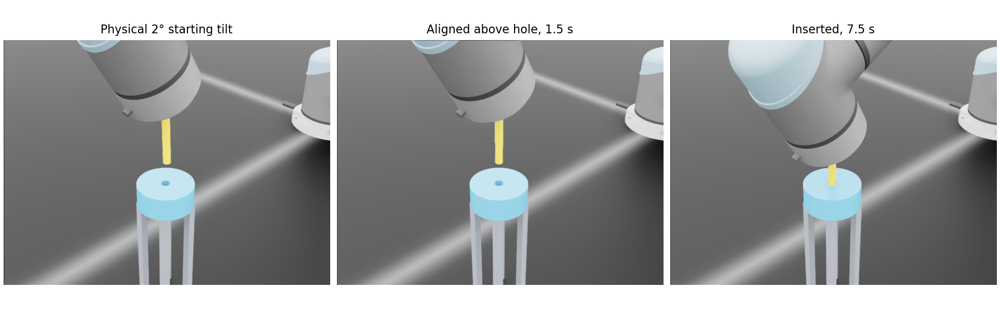

# UR5 · Vision–Language–Action Insertion

**Isaac Lab üzerinde pim–delik yerleştirme araştırması**  
UR5 simülasyonu · OpenVLA-OFT · Uzman gösterimleri · Tekrar üretilebilir deneyler

[](https://github.com/Furkanahii/ur5-vla-insertion/actions/workflows/cpu-checks.yml)

[Başlangıç rehberi](docs/GETTING_STARTED_TR.md) · [Güncel durum](docs/STATUS_TR.md) · [12 haftalık plan](PROJECT_ROADMAP.md) · [HPC kurulumu](HPC_SETUP.md) · [Veri şeması](ur5-pilot/EPISODE_SCHEMA.md)

## Proje ne yapıyor?

Hedefimiz, robotun **kamera görüntüsü + dil talimatı + kendi durumu** üzerinden hareket üreterek bir pimi deliğe yerleştirmesi. Önce simülasyon ve veri hattını doğruluyor, ardından OpenVLA-OFT modelini UR5 gösterimleriyle uyarlamayı hedefliyoruz.

**17 Kasım 2026 durumu:** 1–2. haftanın teknik teslimi tamamlandı; 3–4. haftanın rijit görev ve veri adaptörü pilotları hazır. Öğrencilerin ortak şema incelemesi ve yumuşak delik yapılabilirlik deneyi açık. UR5 üzerinde VLA fine-tuning henüz başlamadı.

## Çalışan örnek



| İzlenecek kayıt | Ne gösteriyor? |
| --- | --- |
| [UR5 temel hareketi](deliverables/week2/ur5-motion.mp4) | Kamera, Kartezyen hareket ve yerçekimi telafisi |
| [Rijit deliğe giriş](deliverables/handoff-2026-11-16/UR5_Yerlestirme_Referans.mp4) | UR5 üzerindeki sabit pimin betikli uzmanla yaklaşık 20 mm girişi |
| [Açılı başlangıç](audit/2026-11-15/angular-dataset/angular-insertion.mp4) | Başlangıç açısının düzeltilmesi ve yerleştirme |
| [Hazır VLA / LIBERO](audit/2026-11-15/libero-demo.mp4) | Hazır OpenVLA-OFT modelinin ayrı bir LIBERO görevini kontrol etmesi |

Videoya tıklayın; GitHub önizleme sunmazsa dosyayı indirin. **LIBERO modeli ile UR5 uzman betiği iki ayrı deneydir.** UR5 videosu öğrenilmiş model başarısı değildir.

## Aşamalar ve kanıt

| Plan | Çıktı | Durum |
| --- | --- | --- |
| 1–2. hafta | Isaac Lab, UR5, kamera, hareket kaydı ve delta replay | Tamamlandı |
| 1–2. hafta | OpenVLA-OFT + LIBERO-10; 10 görevde birer deneme | 10/10 ilk referans başarısı |
| 1–2. hafta | Ortak gözlem/eylem/bölüm sözleşmesi | Teknik kontrol geçti; ekip incelemesi bekliyor |
| 3–4. hafta | Rijit delik, sabit pim ve uzman kontrolcü | Pilot çalışıyor; açık/kenar/kapalı delik kontrolleri geçti |
| 3–4. hafta | Veri adaptörü ve ayrık başlangıçlar | 12 bölüm; 8 eğitim / 2 doğrulama / 2 test |
| 3–4. hafta | Yumuşak delik temas yapılabilirliği | Başlanmadı |
| 5–6. hafta | Büyük veri, UR5 fine-tuning ve öğrenilmiş kapalı çevrim | Başlanmadı |

Önceden alınmış GPU sonuçları 15 Kasım kayıtlarına dayanır. Bu GitHub teslimi yeni bir GPU koşusu başlatmaz. Ayrıntılar: [durum ve sınırlamalar](docs/STATUS_TR.md).

## Nereden başlamalıyım?

1. [Başlangıç rehberini](docs/GETTING_STARTED_TR.md) okuyup iki ayrı deneyin farkını öğren.
2. Yukarıdaki videoları ve [ikinci hafta teslimini](deliverables/week2/README.md) incele.
3. [Gözlem ve eylem sözleşmesini](ur5-pilot/EPISODE_SCHEMA.md) ekipçe gözden geçir.
4. Deneyi yeniden çalıştırmak için [en küçük örneğin rehberini](deliverables/handoff-2026-11-16/README.md) kullan.
5. Sonraki görevleri [ekip çalışma kaydından](ISSUES.md) takip et.

## Depo düzeni

```text
docs/                  Başlangıç, durum, dosya haritası ve kaynak kökeni
ur5-pilot/             Hareket, yerçekimi telafisi, replay ve bölüm şeması
rigid-insertion/       Rijit pim/delik sahnesi, uzman, başarı kontrolü
data-adapter/          RLDS/TFDS dönüşümü ve OpenVLA veri arayüzü
deliverables/week2/    İkinci hafta teslimi, plan ve doğrulama raporları
deliverables/handoff-2026-11-16/
                      Küçük örnek ZIP'i, kısa PDF ve referans video
audit/2026-11-15/      Tarihli ölçümler, görseller, videolar ve tanı kayıtları
HPC_SETUP.md           VALAR / OpenVLA kurulum ve başlatma rehberi
PROJECT_ROADMAP.md     Araştırma planı ve tamamlanma ölçütleri
```

[Ayrıntılı dosya haritası](docs/REPOSITORY_MAP_TR.md) · [Yeniden üretim sınırları](docs/REPRODUCIBILITY_TR.md) · [Kaynak kökeni](docs/PROVENANCE.md)

## GPU olmadan kontroller

Python 3.10 ve NumPy 1.26.4 ile, depo kökünde:

```bash
python -m venv .venv
source .venv/bin/activate
python -m pip install -r requirements-test.txt
python -m unittest discover -s ur5-pilot -p 'test_*.py' -v
PYTHONPATH=ur5-pilot python -m unittest discover -s rigid-insertion -p 'test_*.py' -v
python -m unittest discover -s data-adapter -p 'test_*.py' -v
```

Bu 28 CPU testi; veri zaman sırasını, koordinatları, geometriyi, veri ayrımını ve normalizasyonu denetler. GPU simülasyonu veya model eğitimi yerine geçmez. GitHub Actions aynı kontrolleri çalıştırır.

## Kullanılan ortam ve kapsam

| İş | Doğrulanmış ortam |
| --- | --- |
| UR5 simülasyonu | Isaac Lab 2.3.0 / Isaac Sim 5.1.0, Singularity 4.3.2, Tesla T4 |
| Hazır VLA referansı | OpenVLA-OFT + LIBERO-10, NVIDIA A40 |
| UR5 veri hattı | 1.800 eylem / 1.812 görüntü; 1.144 eğitim / 286 doğrulama chunk'ı |

Container, model ağırlıkları, Python ortamları, ham bölüm klasörleri ve TFDS çıktıları Git'e eklenmez. Tam veri mevcut yerel/HPC çalışma alanında korunur. Parolalar, VPN/SSH hesap bilgileri ve kişisel öğrenme notları bu depoya dahil değildir.

UR5 görevinde pim bileğe sabittir; kavrama öğrenilmez. Uzman simülatörün gerçek delik pozunu kullanır; bu bilgi model girdisine girmez. Ham temas sinyali kalibre edilmiş kuvvet/wrench doğrulaması sayılmaz. A40 üzerindeki UR5 tekrar koşusu, Isaac Sim 6.2.0 uyumluluğu ve gerçek robot doğrulaması henüz yapılmadı.

## Kaynak projeler

[Isaac Lab](https://github.com/isaac-sim/IsaacLab) · [OpenVLA-OFT](https://github.com/moojink/openvla-oft) · [LIBERO](https://github.com/Lifelong-Robot-Learning/LIBERO)

Üçüncü taraf yazılım, model ve varlıklar kendi lisanslarına tabidir. Bu araştırma deposuna ayrıca bir açık kaynak lisansı atanmadı.
