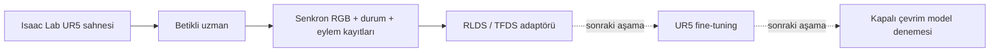

# İlk okuma rehberi

## Beş temel kavram

| Kavram | Bu projede anlamı |
| --- | --- |
| Simülasyon | Robotu ve temas fiziğini bilgisayarda çalıştırdığımız Isaac Lab ortamı |
| VLA | Görüntü, dil ve robot durumundan eylem üreten model |
| Uzman | Deliğin konumunu simülatörden bilerek doğru hareketi hesaplayan betik |
| Bölüm / episode | Başlangıçtan sona bir robot denemesi |
| Fine-tuning | Önceden eğitilmiş modeli kendi UR5 gösterimlerimizle uyarlama |

## Önce neyi anlayalım?

1. [UR5 hareket videosu](../deliverables/week2/ur5-motion.mp4): robotun komutları ve kamera kaydı çalışıyor.
2. [LIBERO videosu](../audit/2026-11-15/libero-demo.mp4): hazır VLA farklı bir robot/görev ortamında çalışıyor.
3. [UR5 insertion videosu](../deliverables/handoff-2026-11-16/UR5_Yerlestirme_Referans.mp4): bizim sahnemizde betikli uzman çalışıyor.

İkinci ve üçüncü adım henüz birleşmedi. Sonraki eğitimde uzman kayıtlarını kullanarak VLA'nın UR5 eylemlerini öğrenmesini deneyeceğiz.

## Veri nasıl akıyor?

Sahne, uzman ve adaptör pilotları çalışıyor. Kesikli bağlantılar henüz yapılmayan eğitim ve politika uygulamasını gösteriyor.

## Bilgisayarımda ne yapabilirim?

- Videoları, görselleri ve raporları inceleyebilirsin.
- README'deki 28 CPU testini Python ile çalıştırabilirsin.
- NVIDIA GPU gerektiren Isaac simülasyonunu Mac üzerinde yerel olarak bu komutlarla başlatamazsın; doğrulanmış yol VALAR/Linux container'ıdır.
- Yeniden simülasyon için [küçük örnek rehberini](../deliverables/handoff-2026-11-16/README.md), LIBERO için [HPC kurulumunu](../HPC_SETUP.md) izle.

## Birlikte inceleme

Furkan ve Maho, [veri şemasındaki](../ur5-pilot/EPISODE_SCHEMA.md) bir örnekte görüntünün eylemden önce geldiğini, metre/radyan birimlerini, TCP noktasını ve gizli hedef pozunun modelden dışlandığını birlikte kontrol etmeli. İnceleme notu [TEAM-01](../ISSUES.md) altında tutulur.
